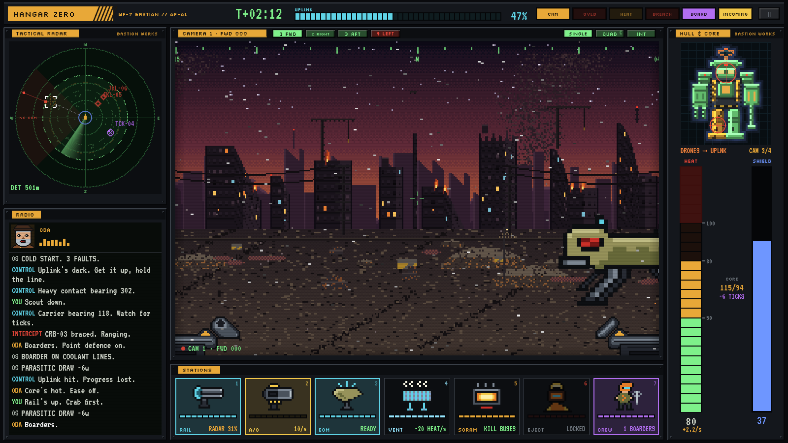
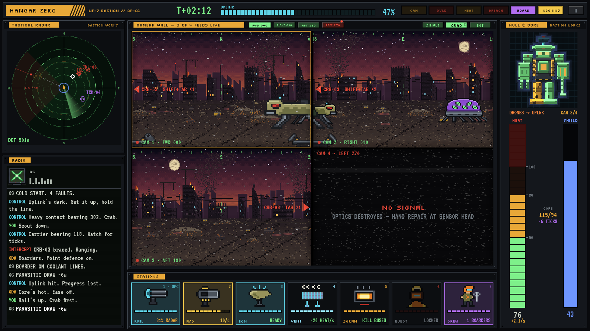
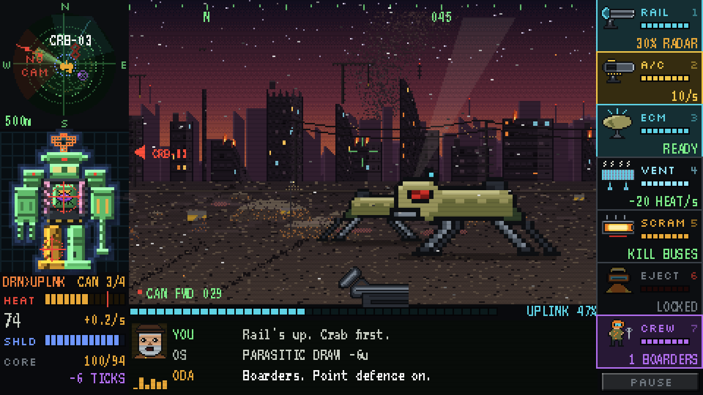
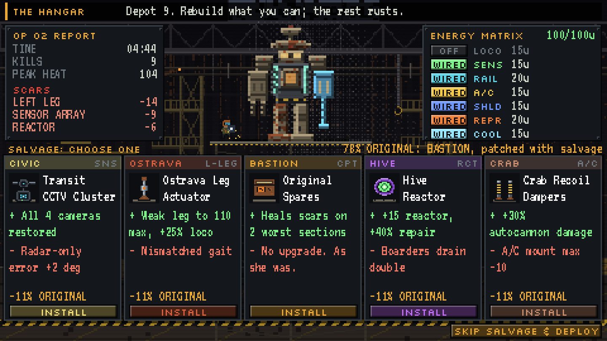
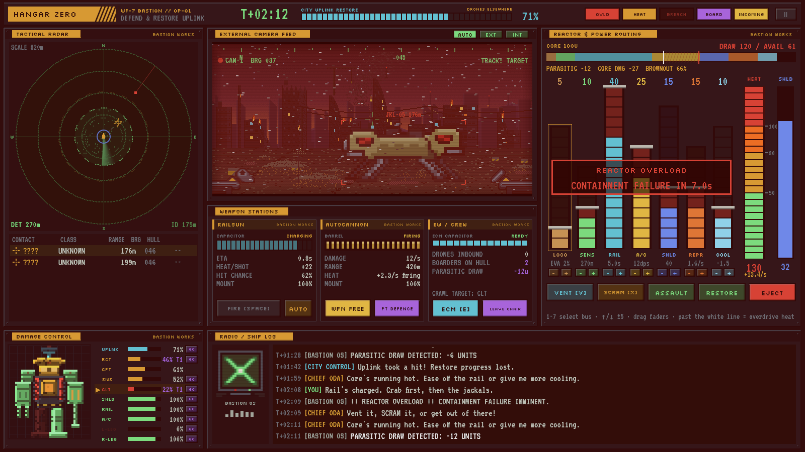
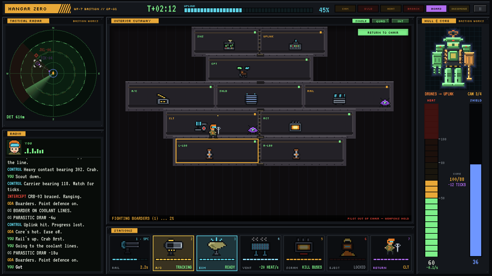
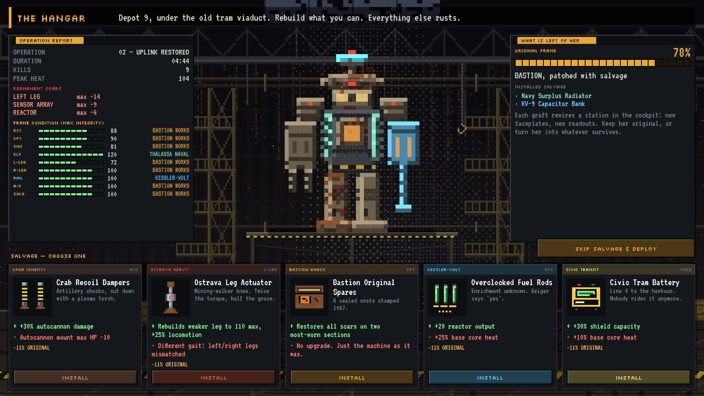
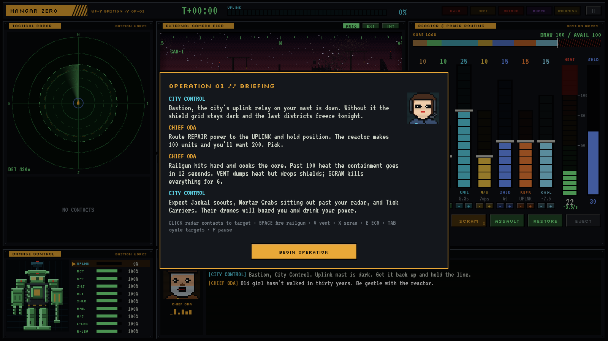

# HANGAR ZERO

*You are the last pilot of a decommissioned walking fortress defending a dying city.*

A cockpit-only mech prototype built with **Bevy 0.20** and **egui** (via `bevy_egui`). You never
see the mech from outside during combat. You get a radar, an external camera, a reactor bus with
more demand than supply, a heat gauge that matters, a damage diagram, and a radio full of people
who need you to hold on a little longer.

The question isn't "can I aim?" It's whether you keep firing the railgun and risk a meltdown,
or cut power and sit still while the scouts close in.





## Android build (Godot 4)

The game is being moved to phones. `godot/` is a **Godot 4.7** port of the whole thing
(GDScript, no plugins): the same rules, the same hand-drawn art, laid out for a landscape phone
at a pixel-perfect 480x270 that the engine scales by whole numbers.





- **Look around** by dragging the camera feed or turning the phone (gyroscope yaw); TAB /
  arrow keys snap between the four hull cameras on a keyboard.
- **Tap** a radar blip or a contact in the feed to target it, a hull section to send the
  repair drones there, a station on the right to use it. Keys 1-7, SPACE, V, X, E, T, P still
  work.
- Everything else is as below: three enemies, the uplink encounter, the reactor overload, the
  hangar with five salvage choices and the energy matrix.

```sh
godot --path godot                                        # run on the desktop (any size window)
godot --headless --path godot --import                    # first time: build the script index
godot --headless --path godot -s tests/test_sim.gd        # rules + 4 seeded autopilot ops
./scripts/godot-shots.sh                                  # staged scenes -> docs/godot/*.png
```

`godot/export_presets.cfg` has an arm64 Android preset; open the project in the editor with the
Android export templates installed and *Project > Export*. The Bevy prototype below stays as
the desktop reference.

## What's in the prototype

| Spec item | Where it is |
|---|---|
| One cockpit screen with radar, power allocation, heat, hull diagram, two weapons | `src/ui/cockpit.rs` |
| Three enemy types: fast scout, artillery platform, boarding drone carrier | `src/sim.rs` (`EnemyKind`) |
| One encounter: defend the mech while restoring a downed subsystem (the city uplink) | `src/sim.rs` (`spawn_waves`, repair drones) |
| One failure state: reactor overload | `src/sim.rs` (`power_and_heat`, `check_outcome`) |
| One hangar screen with five salvage choices | `src/ui/hangar.rs`, `src/campaign.rs` |

All the pixel art is hand-authored as text grids (`src/art.rs`): enemies, portraits, salvage
icons, the interior machinery of every compartment, and the mech's own gun arms framing the
camera feed. The hull diagram is a section map plus a detail overlay (rivets, seams, canopy
glass, reactor glow, barrel rings) shared by the damage display and the hangar portrait. The
city is a two-layer 360° panorama (far layer parallaxes at 60% of the camera bearing) and the
hangar backdrop is painted procedurally at startup, so the game ships no image assets. Fonts are
[VT323](https://fonts.google.com/specimen/VT323) and [Silkscreen](https://fonts.google.com/specimen/Silkscreen)
(SIL OFL, in `assets/fonts`).

### The energy matrix is set in the hangar

The reactor makes **100 units**; the seven systems want **115**. In the hangar you choose what
is wired before you walk — in battle there are no faders to fiddle with, only heat:

| System | Cost | Effect |
|---|---|---|
| LOCO | 15 | Evasive stepping. Dodges artillery and scout fire. A destroyed leg cuts it hard. |
| SENS | 15 | Radar range and tighter radar-only blips. Artillery parks *past* your default radar. |
| RAIL | 20 | Capacitor charge rate. Each shot is +26 heat. |
| A/C | 15 | Autocannon damage and point defence against boarding drones. Heats while firing. |
| SHLD | 15 | Shield capacity and regen. Absorbed hits turn into heat. |
| REPR | 20 | Repair drones work on **one** selected section, or restore the uplink. |
| COOL | 15 | Pulls heat out of the core. Scales with coolant-line health. |

Bastion walks out on op 1 with everything but LOCO wired. Boarding drones bolted to the hull
feed on the bus (parasitic draw); a damaged reactor makes less, and a brownout starves every
system in proportion.

### Stations

Everything the pilot can do is a miniature on the hotbar under the camera feed, `1`–`7`:
RAIL (`Space` too), A/C (toggle; point defence is always on), ECM, VENT, SCRAM, EJECT, CREW.
Each shows its own charge. Fire everything at once and the core heats faster than it cools;
an idle weapon cools.

### Heat and the failure state

Heat comes from the core load, overdrive, railgun shots, autocannon fire, shield absorption,
a damaged reactor, leaking coolant, and failed interlocks after a cockpit breach. Above
**100** the containment countdown starts (12 s). Get below 92 or lose the machine. Your outs:

* **VENT** (`4`) dumps heat fast, but your shields drop for 6 s and the coolant lines take damage.
* **SCRAM** (`5`) kills every bus for 6 s. You're cold, blind and defenceless.
* **EJECT** unlocks during the countdown. You live, Bastion doesn't.



### The cameras are the sensor

Four fixed hull cameras cover the quadrants: FWD 000, RIGHT 090, AFT 180, LEFT 270. The
feed is the biggest thing on the console because it is the mech's eyes, not decoration:

* A contact inside a *working* camera's 90° is **covered**: exact position, class, full
  railgun accuracy, full autocannon damage, and its muzzle flashes are triangulated.
* Anything else is **radar-only**. Its blip is re-sampled once per sweep with a bearing
  error (shown as a ring) that shrinks when you route power to SENS. Railgun hit chance
  falls with that error, the autocannon does half damage, and the station says RADAR LOCK.
* Cameras have their own health. Fire that reaches the sensor head also hits the camera
  facing the shooter; below 20% it shows NO SIGNAL and its quadrant goes radar-only.
  Repair drones can't reach the mast — only the pilot can, by hand, at the sensor head —
  or the hangar may offer a salvaged CCTV cluster.

Bastion starts her first operation already scarred: the LEFT camera is dead, so one
quadrant is radar-only from the first contact.

### Localized damage

The hull diagram is the only damage readout: colour is health, the section being hit lights
up, boarders crawl on it, and the shield is a blue halo around the silhouette that thins as it
drains. Ten sections, each with its own integrity, and each one changes how you play:

* **Legs**: evasion. Losing one leg cuts it by 60%.
* **Sensor array**: radar range, contact ID, camera static, ghost contacts.
* **Coolant lines**: cooling efficiency. Below 35% they leak heat.
* **Cockpit**: below 25% the canopy is breached and a 45 s countdown starts. When it runs
  out the reactor interlocks fail and the core heats permanently.
* **Weapon mounts**: charge rate and damage; a destroyed mount takes the station offline.
* **Reactor**: output.
* **Shield emitters**: capacity.
* **City uplink**: the objective. Artillery can knock restore progress back down.

### Enemies

* **Jackal scout**: fast, circles at 150–210 m and chips random subsystems. The autocannon's job.
* **Mortar Crab**: crawls to ~680 m, braces, and lobs shells with a 4.5 s flight time. The target
  section blinks on the hull diagram. Moving (LOCO) can dodge them. You need SENS power to even
  get a railgun lock at that range. Its muzzle flash gives away a bearing on the radar.
* **Tick Carrier**: hangs at ~340 m and launches boarding drones. Point defence shoots them down
  in flight. The ones that latch on chew their subsystem and steal reactor power.

### Leaving the chair

Click **LEAVE CHAIR**, a hull row's **GO**, or a compartment in the **interior cutaway** and the
pilot crawls through the mech. Once there you can pry boarders off by hand (2.2 s each) or do
hands-on repair (+5/s, no reactor power needed). While you're out of the seat the weapons hold
fire and the power controls are locked.



### The hangar

Each operation leaves **permanent scars**: max integrity lost in proportion to the damage taken.
Then you pick **one of five salvage parts**. Most come from other manufacturers or from the
enemy (Kessler-Volt capacitors, a navy radiator, a Jackal sensor dish, a Hive-grafted reactor
sleeve...). Each has a real upside and a real cost. Installing a part:

* re-stamps that cockpit station's faceplate with the new maker's name and colour,
* can change the readout itself (the Jackal dish turns the round radar into a square-grid scope
  with enemy firmware ghosts),
* lowers the **ORIGINAL FRAME** percentage. Her description drifts from *"WF-7 BASTION, as she left
  the factory"* toward *"the Chimera"*.

Or you take the **Bastion Original Spares** and try to keep her the machine she was.





## Controls

| Input | Action |
|---|---|
| `Tab` / `Shift+Tab` | Turn to the next hull camera clockwise / counter-clockwise |
| `C` / QUAD | Camera wall: all four feeds at once |
| Click radar blip, `T` | Select target (the nearest contact is picked for you after a kill) |
| `1`–`7` / click a station | RAIL · A/C · ECM · VENT · SCRAM · EJECT · CREW |
| `Space` | Fire railgun (needs full charge and a target inside radar range) |
| Click the hull diagram | Send repair drones to that section |
| CREW / interior click | Leave the chair and crawl to a compartment; CREW again returns |
| `P` / `Esc` | Pause |

## Building

```sh
cargo run
```

On Linux you'll need the usual Bevy dependencies (`libudev-dev`, `libasound2-dev`,
`libxkbcommon-dev`, a Vulkan driver). The window opens at 1600×900 and the UI zooms to fit
any size.

```sh
cargo test           # simulation tests, including an autopilot that plays whole missions
```

### Screenshots

The images in `docs/` are real captures from the game, taken headlessly. Each `HZ_SCENE`
stages a moment of an encounter (enemy positions, damage, radio history), lets the real
simulation run for a couple of seconds, then saves the window:

```sh
./scripts/screenshots.sh                  # all scenes, uses xvfb-run
HZ_SCENE=combat HZ_SHOT=out.png cargo run # one scene: briefing | combat | quad | eva | overload | hangar
HZ_SCENE=play HZ_SHOT=docs/play HZ_FRAMES=8 HZ_EVERY=30 cargo run   # autopilot plays; frame strip
python3 -I scripts/strip.py docs/play strip.png 4                    # tile the frames
```

## Code map

```
src/main.rs         app, states (Boot → Cockpit ⇄ Hangar), mission start / flow
src/sim.rs          subsystems, power bus, heat, cameras + radar estimates, enemies, pilot EVA
src/autopilot.rs    scripted pilot for tests and the play scene
src/campaign.rs     scars, salvage catalogue, makers, originality
src/art.rs          pixel sprites (text grids), hull map, procedural city + hangar
src/ui/mod.rs       fonts, palette, riveted panels, pixel buttons and LED bars
src/ui/cockpit.rs   every cockpit station
src/ui/hangar.rs    hangar screen
src/shots.rs        scripted screenshot scenes
```
